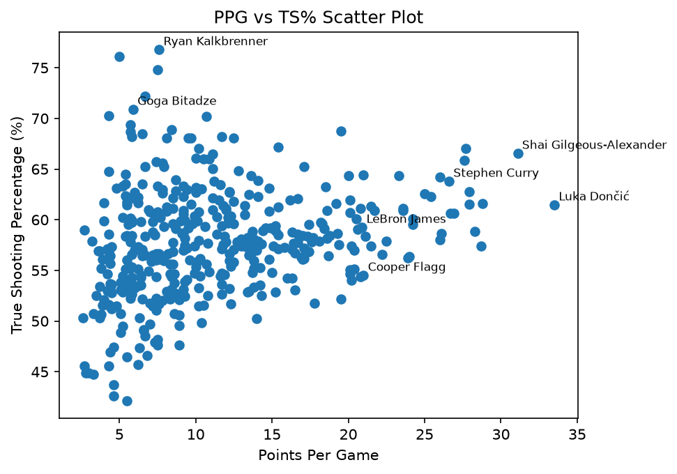
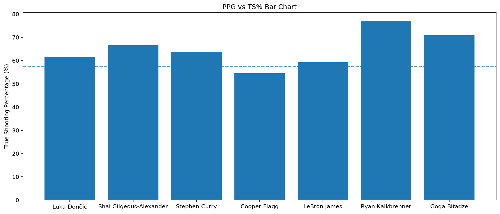

# NBA Player Efficiency Analyzer

## Summary
This project combines my interests in the NBA, data, programming, and statistics to answer one question: are the NBA's highest-scoring players also the most efficient scorers?

Using per-game stats from the 2025-26 regular season, I measure scoring volume with points per game (PPG) and efficiency with true shooting percentage (TS%). I found a weak positive relationship (r = 0.26). Top scorers were somewhat more efficient than the average eligible player, but only 6 of the 41 top scorers were also among the most efficient. The project also includes a small command-line tool for comparing players side by side.

## Data
All data comes from [Basketball-Reference](https://www.basketball-reference.com/leagues/NBA_2026_per_game.html), using the Per Game player table for the 2025-26 NBA regular season only. The CSV is stored in the `data/` folder.

Traded players appear on several rows in this table: one combined line for the season (the team column reads `2TM` or `3TM`) plus one line for each team they played for. The cleaning step handles this (see Methods).

Columns used: `Player`, `Team`, `G`, `MP`, `PTS`, `FGA`, and `FTA`.

## Methods
- One row per player: Each traded player is represented by their combined `2TM`/`3TM` line, and the individual team lines are dropped. This leaves 582 unique players.
- Eligibility filter: I kept players who played at least 20 games, averaged at least 10 minutes per game, and averaged at least 2 field goal attempts per game. I chose these cutoffs before looking at results, with the goal of keeping rotation players (including 10th men) while removing players with only a handful of appearances. This leaves 404 eligible players. The filter is lenient on purpose, which has trade-offs (see Limitations).
- True shooting percentage (TS%): Calculated for each player with the standard formula:

  `TS% = PTS / (2 * (FGA + 0.44 * FTA))`

  TS% counts three-pointers and free throws properly, which plain field goal percentage does not.
- Top scorers: Eligible players at or above the 90th percentile of PPG (41 players).
- Most efficient players: Eligible players at or above the 90th percentile of TS%.
- Statistics:
  - The Pearson correlation coefficient (r) between PPG and TS% across all eligible players, and r² for the share of variation it accounts for.
  - Overlap: the number of players in both top-10% groups, divided by the number of top scorers. If scoring and efficiency were unrelated, about 10% overlap would be expected by chance.
  - The mean TS% of the top scorers compared with all eligible players.

### Hypothesis (written before running the analysis)
I predicted a medium-to-strong positive correlation (*r* between 0.5 and 0.7) and that at least 25% of the top scorers would also be in the top 10% for TS%.

## Findings
| Measure | Result |
|---|---|
| Unique players / eligible players | 582 / 404 |
| Mean TS%, top scorers | about 60% |
| Mean TS%, all eligible players | about 57% |
| Correlation (*r*) between PPG and TS% | 0.26 |
| *r²* | about 0.07 |
| Overlap of the top-10% groups | 6 of 41 players (14.6%) |

The six players in both groups were Shai Gilgeous-Alexander, Nikola Jokic, Giannis Antetokounmpo, Kevin Durant, Austin Reaves, and Zion Williamson.



My hypothesis was not supported. The correlation (0.26) was well below my predicted range, and the overlap (14.6%) was below my predicted 25%, though it is above the 10% expected by chance. In plain terms: players who score more tend to be somewhat more efficient, but scoring volume says little about efficiency on its own, and roughly 93% of the variation in TS% is explained by other factors.

A pattern in the data may help explain this. The players with the very highest TS% were mostly role-playing big men, who take shots at the rim and get to the free throw line, while high-volume stars take harder shots. The top-TS% group averaged 7.6 field goal attempts per game versus 8.6 for all eligible players, so it was not made up of players who barely shoot. My data does not measure shot location or position, so this explanation is a possibility I did not test.



## Limitations
- One season. The results describe the 2025-26 season and may not hold for other seasons.
- Lenient eligibility filter. A few low-volume players with very high TS% (one averaged about 5 PPG) are included, and their TS% is noisy. Rerunning the analysis with a stricter cutoff would show whether this changes the conclusion. I have not done that check yet.
- Players who missed much of the season are excluded. A star who fell below the 20-game cutoff cannot appear in the results.
- Averages hide context. Per-game stats do not capture position, role, or shot location, which likely drive much of the pattern.
- Correlation is not causation. This study shows an association between scoring volume and efficiency, not that scoring more causes a player to be more or less efficient.
- Top-10% groups are small. Each group has about 41 players, so the overlap result can shift by a player or two with small changes to the cutoffs.

## How to Run

### Setup
You need Python 3 and Git installed.

```bash
git clone https://github.com/Pavan-Binwani/NBA-Player-Efficiency-Analyzer.git
cd NBA-Player-Efficiency-Analyzer
python -m venv .venv
```

Activate the virtual environment:

- Windows (PowerShell): `.venv\Scripts\Activate.ps1`
- Mac/Linux: `source .venv/bin/activate`

Install the dependencies:

```bash
pip install -r requirements.txt
```

### Run the analysis
```bash
python explore.py
```

This loads and cleans the data, calculates TS%, prints the comparisons and the correlation, shows the charts, and saves them to the `charts/` folder. Close each chart window to let the script finish.

### Run the player comparison tool
```bash
python compare.py
```

Enter the full names of 2 to 5 players separated by commas, for example:

```
Nikola Jokic, Luka Doncic
```

The tool prints a table of games, minutes, points, field goal attempts, and TS% for each player. Capitalization, extra spaces, and accents do not matter (`luka doncic` matches Luka Dončić). Only players in the eligible group can be compared. The tool rejects blank input, too few or too many players, and names it cannot find, and then asks again. Type `quit` to exit.

## Project Structure
- `explore.py`: runs the analysis, prints the results, and creates the charts
- `data_loader.py`: `load_eligible()` loads the CSV, keeps one row per player, applies the eligibility filter, and calculates TS%
- `compare.py`: the comparison tool (name matching, input validation, and the comparison table)
- `data/`: the Basketball-Reference per-game CSV
- `charts/`: saved chart images
- `requirements.txt`: pinned package versions (pandas and matplotlib)